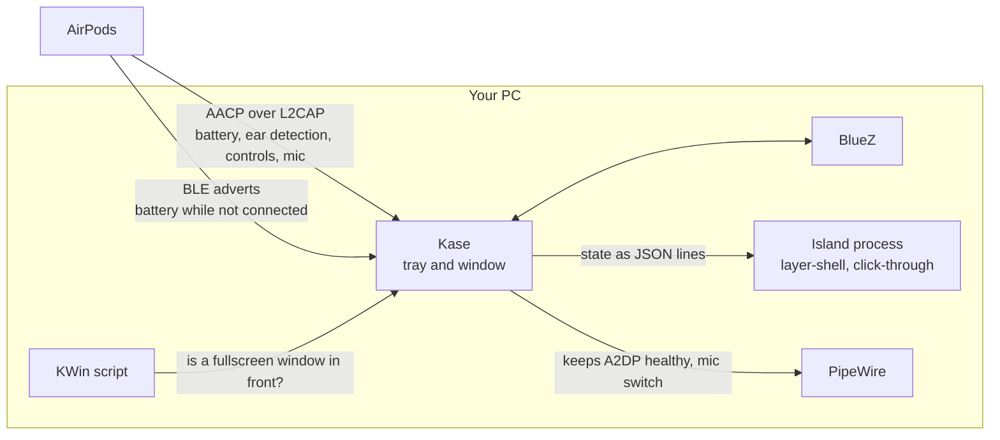

<div align="center">


# Kase

**AirPods for Linux.** Best on KDE Plasma.<br>
Accurate battery for each pod and the case, a Dynamic Island over your games,<br>
and AirPods that switch between your iPhone and your PC the way they do with a Mac.

[](https://github.com/DaBarkle/kase/releases/latest)
[](https://github.com/DaBarkle/kase/actions/workflows/tests.yml)
[](https://github.com/DaBarkle/kase/actions/workflows/flatpak.yml)
[](LICENSE)
[](#compatibility)

[Install](#install) · [Tour](#a-tour) · [Features](#features) · [Compatibility](#compatibility) · [How it works](#how-it-works) · [FAQ](#troubleshooting-and-faq) · [Development](#development)

<br>


<br>

<picture>
  <source media="(prefers-color-scheme: light)" srcset="linux-rust/docs/screenshots/window-airpods-light.png">
  
</picture>
<picture>
  <source media="(prefers-color-scheme: light)" srcset="linux-rust/docs/screenshots/window-island-light.png">
  
</picture>


</div>

> [!NOTE]
> Kase was called **BazzitePods** until version 0.5.0. Same app, same developer. Running
> the install command moves your settings across by itself; see
> [Coming from BazzitePods](#coming-from-bazzitepods).

## Why Kase

Linux can play music through AirPods, but that is where it stops. There is no battery
reading for each pod, no case level, no noise control, and when the AirPods wander off and
come back they often connect without sound. Kase fills that gap with a companion app that
feels like part of the desktop:

- **It just works.** Install once and forget it. Kase starts with your session, finds your
  AirPods by itself and has nothing to set up.
- **It shows the truth.** Left, right and case levels come straight from the AirPods over
  Apple's own control channel, the same way an iPhone reads them.
- **It's made for gaming.** The island floats over fullscreen games, never touches them, and
  draws nothing at all while it rests.
- **It's private.** No account and no telemetry. Kase never connects to the internet.

## Install

Open a terminal and run:

```bash
curl -fsSL https://raw.githubusercontent.com/DaBarkle/kase/main/linux-rust/packaging/install.sh | bash
```

That's it. The command downloads the latest release, installs it as a Flatpak for your
user only (no `sudo`, nothing layered into the system image), and starts Kase in the system
tray. From then on it starts by itself at every login. Pair your AirPods in your
desktop's Bluetooth settings as usual, and their battery shows up within a few seconds.

**Requirements:** a 64-bit PC (x86_64 or ARM64) running Linux with Flatpak and Bluetooth. KDE
Plasma 6 on Wayland gets every feature; see [Compatibility](#compatibility) for the rest.
If Flatpak is missing, the installer tells you the command for your distribution. It adds
the Flathub remote if it's missing, because the app runs on the Freedesktop runtime from
Flathub.

| To | Run |
| --- | --- |
| **Update** to the latest release | the same install command again |
| **Install a downloaded bundle** | `... \| bash -s -- ~/Downloads/Kase.flatpak` |
| **Uninstall** (app, its data and autostart) | `... \| bash -s -- --uninstall` |

Here `...` stands for the `curl` part of the install command. The installer is a single
readable script, [`install.sh`](linux-rust/packaging/install.sh), and you
can read it before you run it. The old `install-bazzite.sh` link still works.

### Coming from BazzitePods

Run the install command above. The installer:

1. copies your settings, saved AirPods and Flatpak overrides from
   `io.github.dabarkle.BazzitePods` to `io.github.dabarkle.Kase`,
2. removes BazzitePods and its old autostart entry,
3. installs and starts Kase.

[Apple device mode](#apple-device-mode) is a system setting, so it stays as it is.

## A tour

### The island

The island sits at the top center of your screen, like the Dynamic Island on an iPhone.
It changes shape to show what matters right now and moves on springs, the way the real
thing does: it grows out of a small pill with a little bounce, its contents cross-fade,
rings sweep in one after another and percentages roll when they change. While something
charges, a faint light runs round its ring (a few times, never over a game). The L or R
label dims while that pod is out of your ear. A change that arrives mid-animation bends the
motion instead of restarting it.

<div align="center">

<br>

</div>

When the AirPods connect it opens into a **card** with a ring for each pod and the case,
then folds into a **slim island** with all three levels. When something happens it morphs
into a short **alert** that names the one thing that changed:

<div align="center">

</div>

When the AirPods connect from the open case, the card shows both pods and the case for
about 6 seconds and folds away 2 seconds after you take a pod out. With AirPods 4 the card
opens with a 3D animation of the lid swinging open and the pods rising out, played at your
monitor's refresh rate (just the last frame with **Reduce motion**). The AirPods tab plays it
too. Closing the lid with the
pods inside doesn't pop a *Disconnected* alert. The case card is never shown over a
fullscreen game or video; turn it off with **Show a card when I open the case** in the
Island tab.

#### Styles

<p align="center">
  
  &nbsp;
  
</p>

- **Purist** (default, left) is the Dynamic Island as it really is: solid flat black with a
  hairline edge. When something happens, light runs round the border in that event's
  colour, and after under two seconds the island is still again.
- **Classic** (right) is smoked glass with a sheen and a soft shadow. Its **Glass** slider
  goes from the island's pure black to clear glass.

Each kind of event has its own light, so you can tell what happened from the corner of
your eye:

| Event | Light |
| --- | --- |
| The AirPods connect | a spectrum flows round the edge |
| Charging starts | a green sweep |
| A pod or the case runs low | a slow amber breath, red at 10% or below |
| The audio moves to or from another device | a blue sweep |
| Noise control changes | a ping: blue for Noise Cancellation, a spectrum for Adaptive |
| You swap to the AirPods mic | an orange ping, the colour iOS uses for a mic in use |
| The AirPods mic can't be used | a red ping and a quick shake of the head |
| The AirPods disconnect | a dim sweep |

#### Behaviour in games

Pick how much of the island you want to see in the **Island** tab:

| Mode | What you see |
| --- | --- |
| **Compact** (default) | The slim island stays on screen and opens on changes. |
| **Pop-up** | The island opens on changes, then hides. |
| **Full** | The card stays on screen, and news shows in its second line with a small bounce. |
| **Off** | Never shown. |

<p align="center">
  
</p>

- **Four sizes.** Small, Medium, Large and Extra large scale the whole island, for big or
  high-resolution screens.
- **Six places.** Click a spot on the preview screen in the Island tab to move it to any
  corner, or the top or bottom center.
- **Opacity over games.** The island turns see-through only while a fullscreen game or
  video is in front, and stays solid on the desktop.

#### Switching devices

<div align="center">

</div>

Your PC is home. When your iPhone plays something, it gets the AirPods: Kase pauses what's
playing here and the island shows **Playing on iPhone**, while the AirPods stay connected.
A few seconds after the iPhone stops, they come back to the PC by themselves, even if
you're in another room. Press play in any app on the PC, or **Use on this PC** in the
window, and they come back straight away.

While you game, watch something or sit in a Discord call, a notification on your phone
only borrows the AirPods for its sound; they're back on the PC about three seconds later.
A phone call is never interrupted. If you'd rather the AirPods stay on the iPhone until you
press play on the PC, as with a Mac, turn off **Bring AirPods back to this PC** in Settings.

When the AirPods leave the PC, for the iPhone or for the day, Kase keeps looking for them.
Open the case when you get home, or just sit down and unlock the PC, and they reconnect
without a trip to the Bluetooth menu. Kase listens to the AirPods' own Bluetooth adverts:
opening the lid starts a connect at once. After the pods go into the case, it also tries
every 8 seconds for 15 minutes while you're at the PC (screen unlocked, not idle, nothing
fullscreen). Otherwise it tries every 20 seconds for 3 minutes, then every minute.

While your iPhone shares the AirPods, **Stay connected alongside my iPhone** (Settings →
AirPods, on by default) asks them to keep this PC on their list of devices, so they don't
drop it for the iPhone.

When the AirPods connect, the sound goes to them. Kase leaves it alone if you pick another
output while they're connected, while both pods are in the case (it moves when you take one
out), while another device is playing on them, or when your default is a virtual output
such as EasyEffects.

Press **Disconnect** in your desktop's Bluetooth settings and the AirPods stay disconnected,
even after Kase restarts, a reboot or suspend. Connect them again any way you like (the
Bluetooth settings, `bluetoothctl`, or the AirPods connecting by themselves) and Kase looks
after them as before. Unpairing them also clears it.

### The app window

The window has three tabs. **AirPods** shows a status island that glows green when the
AirPods are connected and amber or red when a pod runs low, the battery rings, and on models
with noise control the listening modes and conversation awareness. **Island** places and
styles the overlay on a preview screen. **Settings** holds the appearance, start at login,
the AirPods' own settings and Apple device mode. Light and dark follow your system, or you
can pick one.

The window tells you what your AirPods are doing at a glance:

<p align="center">
  
  
  
  
  
  <br>
  <sub>Connected &nbsp;·&nbsp; On another device &nbsp;·&nbsp; Away &nbsp;·&nbsp; In the case &nbsp;·&nbsp; Low battery</sub>
</p>

A pod that drops out keeps its last level, greyed out, instead of showing 0%. The case
keeps its last known level after the pods come out, marked with how long ago it was seen.

### Apple device mode

AirPods behave best with devices that introduce themselves as Apple devices: they switch
between them automatically and stay paired with both your iPhone and your PC. Apple device
mode makes your PC's Bluetooth report Apple's vendor ID to the AirPods. It's off by default
and is one switch in the **Settings** tab:

<p align="center">
  
  
  
  <br>
  <sub>1. Flip the switch &nbsp;→&nbsp; 2. Confirm &nbsp;→&nbsp; 3. Enter your password</sub>
</p>

Your system asks for your password, Bluetooth restarts, and your devices drop for a few
seconds and reconnect on their own. Turn it off the same way to get your original
Bluetooth settings back. No terminal needed.

<details>
<summary><b>What it changes, and how to do it by hand</b></summary>

<br>

Kase adds `DeviceID = bluetooth:004C:0000:0000` under `[General]` in
`/etc/bluetooth/main.conf` (keeping a one-time backup at `main.conf.bak-kase`) and
restarts Bluetooth. If you had set a `DeviceID` yourself, it's commented out and restored
when you turn the mode off. The script is a constant built into the app
([`apple_mode.rs`](linux-rust/src/apple_mode.rs)) and runs through the standard system
password prompt (`pkexec`), so it can never run without your password. Changes in `/etc`
are kept across system updates (Bazzite and other image-based systems included), and your other Bluetooth devices are not affected.

To turn it on by hand:

```bash
sudo cp -a /etc/bluetooth/main.conf /etc/bluetooth/main.conf.bak-kase
sudo sed -i '/^\[General\]/a DeviceID = bluetooth:004C:0000:0000' /etc/bluetooth/main.conf
sudo systemctl restart bluetooth
```

To undo it by hand:

```bash
sudo sed -i '/^DeviceID = bluetooth:004C:/d' /etc/bluetooth/main.conf
sudo systemctl restart bluetooth
```

</details>

### The AirPods mic switch

<div align="center">

</div>

Keep your good desk mic for gaming and calls, and switch to the AirPods' mic when you walk
away from the desk, without dropping the music to phone-call quality. Turn on **AirPods mic
switch** in Settings, then:

- **Hold the left stem** to swap between your desk mic and the AirPods mic. A soft rising
  chime means the AirPods mic is on, a falling one means the desk mic is back.
- **Hold the right stem** to change noise control (models with noise cancellation).

Apps follow the swap on their own, including Discord and apps that use EasyEffects' mic.
The PC goes back to the desk mic by itself when the AirPods go to another device, a call
starts, both AirPods leave your ears, or the AirPods stop sending mic audio.

<details>
<summary><b>Good to know</b></summary>

<br>

- Music stays on high-quality AAC (where your distribution provides it: Fedora, Bazzite,
  Arch, SteamOS; otherwise SBC) because the AirPods send their mic over a separate
  stream, the way they do for an iPhone or a Mac, instead of switching to the headset
  profile.
- While the AirPods mic is in use, the AirPods themselves lower the music quality slightly.
  That happens inside the AirPods (the PC keeps sending full quality), so the mic stream
  only runs while the AirPods mic is selected.
- While the switch is on, stem holds belong to Kase on every device, so on an iPhone a hold
  won't change noise control until you turn the switch off.

</details>

### The tray

<div align="center">

</div>

The tray icon is a battery ring around a little AirPods case. It turns amber, then red, as
the battery runs low, shows a bolt while charging, and greys out when the AirPods are
disconnected. Closing the window keeps Kase running in the tray.

Click the icon for a **quick look**: a small black card springs out of the corner by the
tray with the left, right and case rings, a row to change noise control, and **Open Kase**
for the full window. It goes away when you move off it, press Esc or click the icon again.
Where it can't be shown (GNOME, which has no layer-shell), or if you switch off **Quick look
from the tray** in **Settings**, clicking the icon opens the window as before. Right and
middle click are unchanged.

### Motion

The window moves like the island: on connect the rings fill one after another while the
numbers count up with them, and later changes roll like an odometer. When charging starts
the bolt pops in, a green ripple leaves the ring and a faint light runs round it while it
charges. Tab pages slide in from the side of the tab you picked, the status pill stretches
to fit its new text and cross-fades its colour, and buttons dip slightly when pressed.
Ctrl+Tab and Ctrl+Shift+Tab move between the tabs, with a focus ring on the tab bar.

**Reduce motion** in **Settings** follows your desktop by default: KDE's animation speed
set to *Instant*, or GNOME's *Animations* switched off. With it on, slides and morphs
become short fades and nothing loops, in the window and on the island alike.

## Features

**Battery you can trust**
- Left, right and case levels, with charging state
- Read from the AirPods' control channel while connected, and from their Bluetooth
  adverts while they're nearby but not connected
- Last known levels, marked with how long ago, instead of 0%
- *In case* when both pods are put away

**The island**
- Card, slim island and alerts, on springs
- A case card with both pods and the case when you open the lid, with a 3D lid-open
  animation for AirPods 4
- Purist and Classic styles, four sizes, six places
- Translucent over fullscreen games, solid on the desktop
- Redraws only while it moves; at rest it uses no CPU

**Controls**
- Noise control: Noise Cancellation, Transparency, Adaptive, and optionally Off
- Conversation awareness, Personalized Volume, Adaptive Audio strength
- Automatic ear detection, which pauses and resumes your media
- Rename, microphone side, noise cancellation with one AirPod
- Stem press track control: double-press for next, triple-press for previous

Only the controls your model supports are shown.

**Audio that keeps working**
- Fixes "walked away, came back, connected but silent"
- Never leaves the audio card switched off, and repairs a stalled connection by itself
- Returns to AAC after a fallback codec (AAC where your distribution provides it: Fedora,
  Bazzite, Arch, SteamOS; otherwise SBC)
- The sound goes to the AirPods when they connect, unless you chose another output
- Reconnects when the AirPods come back, however long they were away, including after a
  day out with your iPhone
- Opening the case lid reconnects them within seconds
- Disconnecting on purpose keeps them disconnected, across restarts, reboots and suspend

**Multiple devices**
- Your PC is home: the AirPods come back a few seconds after your iPhone stops
- Optionally stays connected alongside your iPhone, so the AirPods don't drop the PC
- A phone notification never keeps them while you game, watch or talk on Discord
- Works with apps that don't report playback, such as games and the Plex desktop app
- Never interrupts a phone call
- Optional Apple device mode for Mac-like switching

**Hands-off**
- Starts at login, minimized to the tray
- Survives Bluetooth restarts, adapter hot-plug and suspend and resume
- Never turns Bluetooth on by itself
- Launching it again just opens the window

## Compatibility

### Desktops

| Desktop | Island overlay | Battery and controls | Tray | Starts at login |
| --- | :---: | :---: | :---: | :---: |
| **KDE Plasma 6, Wayland** (the best experience) | ✅ with fullscreen transparency | ✅ | ✅ | ✅ |
| KDE Plasma 5, Wayland | ✅ with fullscreen transparency | ✅ | ✅ | ✅ |
| Hyprland, Sway, niri and other wlr-layer-shell compositors | ✅ with fullscreen transparency | ✅ | needs a tray bar (e.g. Waybar) | add `flatpak run io.github.dabarkle.Kase --start-minimized` to your compositor's startup (Kase shows you the line) |
| GNOME | Desktop notifications instead | ✅ | needs the AppIndicator extension (built into Ubuntu) | ✅ |
| Any desktop on X11 | Desktop notifications instead | ✅ | ✅ | ✅ |
| Steam Gaming Mode (gamescope) | ❌ | ✅ | ❌ | from desktop mode |

### AirPods

| Model | Battery | Noise control | Adaptive and conversation awareness |
| --- | :---: | :---: | :---: |
| AirPods 4 with Active Noise Cancellation | ✅ | ✅ | ✅ |
| AirPods 4 | ✅ | | |
| AirPods Pro 2 and Pro 3 | ✅ | ✅ | ✅ |
| AirPods Pro (1st generation) | ✅ | ✅ | |
| AirPods Max | ✅ | ✅ | |
| AirPods (1st to 3rd generation) | ✅ | | |

Ear detection works on every model with pods. Kase is developed and tested day to day on
AirPods 4 with Active Noise Cancellation; the other models use the capability tables from
LibrePods. If something doesn't look right on yours, please
[open an issue](https://github.com/DaBarkle/kase/issues).

## How it works



1. **Talking to the AirPods.** Kase opens Apple's private control channel (AACP) to the
   AirPods through BlueZ (the standard Linux Bluetooth system), the same way an iPhone does. That gives exact battery levels for
   each pod and the case, ear detection, noise control, device switching and the mic stream.
   While the AirPods are away, it decrypts their Bluetooth LE adverts instead, so you still
   see levels when you open the case nearby.
2. **One source of truth.** Everything the AirPods report goes into a single state hub. The
   window, tray and island all draw from it, so they never disagree.
3. **The island** is a separate small process on the compositor's overlay layer. It only
   sets up the GPU while it's visible, and redraws only while it moves.
4. **Fullscreen detection.** A tiny KWin script (on Plasma 5 and 6), or the compositor's
   window list on Sway, Hyprland and niri, tells Kase when the active window is fullscreen,
   so the island can turn translucent. It's a question to the window manager, not a look
   at the game.
5. **Audio guard.** Kase watches the Bluetooth audio profile and your default output. If the
   AirPods come back connected but silent, it renegotiates the connection and restores your
   output.

The design rules and module map are in [`ARCHITECTURE.md`](linux-rust/docs/ARCHITECTURE.md).

### Safe with anti-cheat

The island is an ordinary desktop surface drawn by its own process on the compositor's
overlay layer (`wlr-layer-shell`). It never touches a game:

- no Vulkan or OpenGL layers, no `LD_PRELOAD`, no injection or hooking
- no `ptrace`, and no reading other processes' memory or `/proc`
- no screen capture: the island never reads what's behind it
- click-through, and it never takes keyboard focus

### Permissions

Kase runs in the Flatpak sandbox with only what it needs. Every permission is explained in
the [Flatpak manifest](linux-rust/flatpak/io.github.dabarkle.Kase.yml):

| Permission | Why |
| --- | --- |
| Wayland (X11 as a fallback), GPU | the window and the island |
| PulseAudio socket | audio profile repair and the mic switch |
| Bluetooth, host network namespace | AACP runs on a raw Bluetooth socket, which only exists in the host's network namespace. Kase has no networking code and never talks to the internet. |
| BlueZ, logind, screen saver | device state, and reconnecting around suspend and when you come back to the PC |
| KWin, tray, notifications, MPRIS | fullscreen detection, the tray icon, alerts on GNOME, pausing media |
| Flatpak host commands | Apple device mode's single fixed script, behind your password |

No file system access, no full session or system bus.

## Troubleshooting and FAQ

<details>
<summary><b>The battery doesn't show up</b></summary>

<br>

Make sure the AirPods are paired and connected in your desktop's Bluetooth settings, and that
Kase is running (look for its icon in the tray, or open it from the app menu). Kase finds
paired AirPods by itself; there is nothing to set up in the app.

</details>

<details>
<summary><b>The case level is old or missing</b></summary>

<br>

That's how AirPods work: the case reports its level only while at least one pod is inside
it with the lid open, the same as on an iPhone. Kase keeps the last reading and shows how
long ago it was seen. Open the lid near the PC to update it.

If levels are slow to update while the AirPods aren't connected to the PC, turn on
**Quicker battery updates when not connected** in **Settings → Diagnostics**. It switches
on a newer Linux Bluetooth feature that's still labelled experimental, and Bluetooth
restarts for a few seconds when you change it.

</details>

<details>
<summary><b>I don't see the island</b></summary>

<br>

Check that **In games** isn't set to **Off** in the Island tab, and press **Show on
screen** to test it. The island needs a compositor with `wlr-layer-shell`, such as KDE
Plasma or Hyprland. On GNOME you get desktop notifications instead, and Steam Gaming Mode
has no overlay layer for apps.

</details>

<details>
<summary><b>The AirPods are connected but there's no sound</b></summary>

<br>

Kase repairs this by itself within a few seconds. If it doesn't, attach Kase's log,
`~/.var/app/io.github.dabarkle.Kase/.local/state/kase/kase.log`, to
[an issue](https://github.com/DaBarkle/kase/issues). For more detail, run it with debug
logging:

```bash
flatpak kill io.github.dabarkle.Kase
flatpak run io.github.dabarkle.Kase --debug 2>&1 | tee ~/kase-debug.log
```

</details>

<details>
<summary><b>The window or island is blank, flickers or won't open (NVIDIA, older GPUs)</b></summary>

<br>

Kase draws with Vulkan by default. If your GPU or driver has trouble with that, switch it
to OpenGL, or to software drawing, then restart Kase:

```bash
flatpak override --user --env=WGPU_BACKEND=gl io.github.dabarkle.Kase       # OpenGL
flatpak override --user --env=ICED_BACKEND=tiny-skia io.github.dabarkle.Kase  # software, no GPU needed
```

On NVIDIA, also check that the Flatpak GL extension matches your driver: `flatpak list |
grep nvidia` should show the same version as `nvidia-smi`. If not, run `flatpak update`.

On a laptop with two GPUs, pick which one Kase uses with
`flatpak override --user --env=WGPU_POWER_PREF=low io.github.dabarkle.Kase` (the
power-saving one) or `=high` (the fast one). Undo any of these with
`flatpak override --user --reset io.github.dabarkle.Kase`.

</details>

<details>
<summary><b>The AirPods don't reconnect by themselves</b></summary>

<br>

If you pressed **Disconnect** on this PC, Kase leaves them disconnected on purpose, even
after a restart. Connect them once from your desktop's Bluetooth settings and Kase
reconnects them by itself again from then on. The log says
`remembered Disconnect pressed on this PC; not reconnecting` when this is why.

</details>

<details>
<summary><b>Does it work in Steam Gaming Mode?</b></summary>

<br>

Battery, controls, audio repair and switching work wherever Kase runs, but gamescope has no
overlay layer for other apps, so the island is a desktop-mode feature.

</details>

<details>
<summary><b>Can my AirPods get banned or my games flagged?</b></summary>

<br>

No. Kase talks to the AirPods the way an iPhone does, and the island never touches a game.
See [Safe with anti-cheat](#safe-with-anti-cheat).

</details>

## Development

Kase is written in Rust with [iced](https://github.com/iced-rs/iced) for the interface,
[bluer](https://github.com/bluez/bluer) for Bluetooth and libpulse for audio. It lives in
[`linux-rust/`](linux-rust).

```bash
cd linux-rust
cargo build --release   # builds the app (kase) and the island (kase-overlay)
cargo test              # no Bluetooth, AirPods, sound server or display needed (or: just test)
just flatpak            # builds and installs the Flatpak
```

Building needs Rust, `pkg-config` and the development files for D-Bus, PulseAudio,
xkbcommon, Wayland and libavcodec:

| Distribution | Packages |
| --- | --- |
| Fedora | `sudo dnf install gcc pkgconf-pkg-config dbus-devel pulseaudio-libs-devel libxkbcommon-devel wayland-devel ffmpeg-free-devel` |
| Arch | `sudo pacman -S base-devel pkgconf dbus libpulse libxkbcommon wayland ffmpeg` |
| Ubuntu / Debian | `sudo apt install build-essential pkg-config libdbus-1-dev libpulse-dev libxkbcommon-dev libwayland-dev libavcodec-dev` |

<details>
<summary><b>Project layout</b></summary>

<br>

| Path | What's there |
| --- | --- |
| `src/main.rs`, `src/lib.rs` | the `kase` program's arguments, and the library everything else lives in |
| `src/supervisor.rs` | starts the services and runs one AirPods session at a time |
| `src/bluetooth/` | AACP (the AirPods control protocol) and LE advert decryption |
| `src/devices/` | the AirPods session: handshake, reconnect, device switching |
| `src/core/` | battery rules and the AirPods model table |
| `src/hub.rs` | the single state hub everything draws from |
| `src/audio/` | the audio guard (A2DP health, codec, default output) |
| `src/mic/` | the AirPods mic: stream decoding, virtual mic, switching, chimes |
| `src/ui/` | the window, tray, springs and styles |
| `src/bin/kase-overlay/` | the island: shapes, springs, purist shader, alerts |
| `flatpak/`, `packaging/` | Flatpak manifest, app metadata and the installer |

</details>

<details>
<summary><b>Previewing the UI without AirPods</b></summary>

<br>

Both binaries have demo modes with fake AirPods, which is how the screenshots here are made:

```bash
kase --ui-demo pro                               # also: airpods4, max, low, elsewhere, disconnected, incase, putaway, empty, btoff
KASE_UI_TAB=island kase --ui-demo                # open on a given tab: airpods, island or settings
kase-overlay --demo-story --style purist         # a scripted tour of every island state
kase-overlay --demo --step 3 --size extra_large  # one sample state, at a given size
```

</details>

**Testing.** Every pull request runs the full test suite with a coverage floor and builds
the Flatpak. Hardware test steps for a release are in [`TESTING.md`](linux-rust/docs/TESTING.md),
and every change is listed in the [changelog](linux-rust/CHANGELOG.md).

**Contributing.** Bug reports, ideas and pull requests are welcome in
[issues](https://github.com/DaBarkle/kase/issues). For code changes, please keep to
the hard rules at the top of [`ARCHITECTURE.md`](linux-rust/docs/ARCHITECTURE.md) and add
tests next to the module you change.

## Acknowledgements

Kase stands on [**LibrePods**](https://github.com/librepods-org/librepods) by Kavish Devar
and the LibrePods contributors, who reverse-engineered Apple's AirPods protocol. The AACP
implementation, the LE advert decryption and the Rust Bluetooth groundwork come from
LibrePods. Kase builds a new desktop app around them: the island, the window and tray, the
battery and audio logic, device switching, the mic switch and the packaging. The AirPods
mic stream follows the approach found in LibrePods
[pull request #655](https://github.com/librepods-org/librepods/pull/655). **Stay connected
alongside my iPhone** follows an idea and protocol detail from
[EarPort](https://github.com/Anoryth/earport) by Anoryth (GPL-3.0), reimplemented for Kase.

This repository is a fork of LibrePods, trimmed to the Kase desktop app in `linux-rust/`.
LibrePods' notes on the AirPods protocol live on in
[`linux-rust/docs/protocol/`](linux-rust/docs/protocol/). Upstream's original branches are
kept as `upstream-main` and `linux/rust`.

The interface uses the [Inter](https://rsms.me/inter/) typeface (SIL Open Font License).

The AirPods 4 case-open animation is rendered from
["AirPods 4"](https://sketchfab.com/3d-models/airpods-4-e44730974131402eb496352cab19c82e) by
[Falah3D](https://sketchfab.com/3dFalah), licensed under
[CC BY 4.0](http://creativecommons.org/licenses/by/4.0/).

## Licence

Kase: AirPods for Linux<br>
Copyright © 2025 LibrePods contributors<br>
Copyright © 2026 Kase contributors

This program is free software: you can redistribute it and/or modify it under the terms of
the GNU Affero General Public License as published by the Free Software Foundation, version
3 of the License. It is distributed in the hope that it will be useful, but WITHOUT ANY
WARRANTY; without even the implied warranty of MERCHANTABILITY or FITNESS FOR A PARTICULAR
PURPOSE. See the [GNU Affero General Public License](LICENSE) for details.

Kase is not affiliated with, endorsed by or sponsored by Apple Inc. or KDE e.V. AirPods,
iPhone and Mac are trademarks of Apple Inc. KDE and Plasma are trademarks of KDE e.V. All
other trademarks belong to their respective owners.
